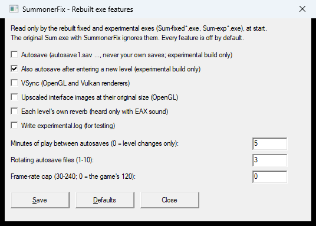
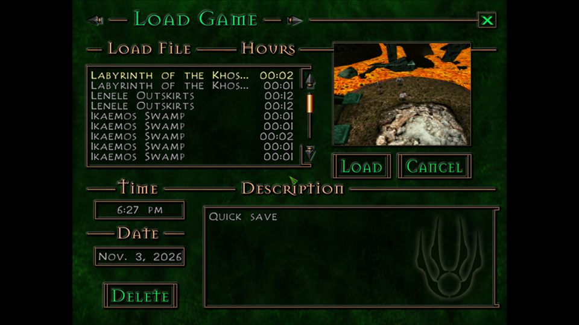

# Experimental build: new features in the source

**2026-11-01:** every feature here except autosave and the Tentacle Beast grab is in the [fixed build](fixed-build.md#features-from-the-experimental-build-2026-11-01)
too (their gates are `FIXED_BUILD`); the experimental build is the fixed build plus those two.

**Status (2026-10-21):** the framework and four features are written (controller, tentacle grab, autosave, frame-rate
cap and vsync) and smoke-tested in the game the same evening (agent mode, test saves); see "In-game tests" below.
**2026-10-24/25:** upscaled interface and fonts (`HiResInterface`), the widescreen interface and the game options in the
source, parity with the original game plus SummonerFix (below), and the tentacle grab seen in game.

The experimental build (`node tools/link-build.mjs --config experimental`, `build/link-exp/Sum-exp.exe`) is the
[fixed build](fixed-build.md) plus new features, as planned in [Fixed and experimental builds](builds.md). The user
decided (2026-10-21) on one tree with three configurations, so the features are written in the same source, behind
`EXPERIMENTAL_BUILD`.

## How it is built

- **The code** is in `src/decomp/experimental/`, one file per feature, plus `#ifdef EXPERIMENTAL_BUILD` blocks in game
  files where a feature must change the game's own code (the Tentacle Beast grab). `link-build` compiles that folder
  only for the experimental configuration. The byte matching never reads it, and the shipped `Sum-rebuilt.exe` stays
  byte-identical apart from the timestamp (checked when the framework was added).
- **The hooks.** Three calls from the game's code, each under the define (`include/experimental/experimental.h`):
  `exp_frame_begin` in `GameTick` (0x401070) after the mouse is read, for input; `exp_frame_end` before `FrameEnd`,
  for per-frame work; `exp_level_loaded` at the end of `level_load` (0x438570). Each feature's init runs at the first
  frame.
- **64-bit (2026-10-26):** `--config experimental --compiler clang --arch x64` builds the same features as a 64-bit
  exe, which is the player build of the modern port: SummonerFix's remaining layers (keys, brightness, the registry
  settings, the centred menus) are in its in-source host ([Modern C++ port](future/modern-port.md#the-player-build-the-64-bit-experimental-exe-2026-10-26)).
- **The switches** are in `summonerfix.ini` next to the exe, the file `SummonerFixConfig.exe` edits, each off by
  default: a problem can always be ruled out by turning a feature off. `[Debug] ExperimentalLog=1` writes
  `experimental.log` next to the exe.
- **SummonerFix stands down** for a feature the exe has in its source: such code carries
  `// EXPERIMENTAL_BUILD: <feature> <Key>`, `link-build` writes the key into `Sum-exp.fixes`, and SummonerFix's
  `RebuiltFixInSource` check leaves its own version out. The controller depends on it (SummonerFix then forwards agent
  mode's `pad` to the exe's `ExpControllerSetSynthetic` export); for the tentacle grab it is only a safeguard, because
  SummonerFix never installs its tentacle patches in a rebuilt exe (so the log shows no tentacle line there).

## Features

*SummonerFixConfig's Features... window, 2026-11-03.*

All are written, compile, and keep the shipped build unchanged.
Switches are in the config app: **Features...** (named **Experimental...** until 2026-11-01: autosave, frame-rate cap, vsync, upscaled interface, level reverb, the log), **Controller...**,
and the Tentacle Beast box on the main window.

| Feature | Switches | Spec / where | Status |
|---|---|---|---|
| Controller, tier 1 | `[Controller] Enabled` and the mapping keys | SummonerFix `controller.c` (the user's test: Xbox-style controllers work, a PS5 DualSense does not); `experimental/controller.cpp` on the game's own input (`mouse_set_pos`, `key_mark`, `mouse_mark_button`), any renderer | cursor tested |
| Tentacle Beast grab and throw (G250, G251) | `[Experimental] TentacleGrab`, `TentacleGrabChance`; `[Debug] TraceTentacle` | SummonerFix `tentacle.c`, [Tentacle grab](future/tentacle-grab.md); in `game/unnamed_tentacle_beast_0x4c6480.cpp` | tested 2026-10-25: grab, hold, throw, landing and a second grab seen in the sewer boss arena |
| Level reverb (K261) | `[Experimental] LevelReverb` | new; `experimental/levelreverb.cpp`, one call in `game/level_scripts_common.cpp`: without a loose `data\internal\<level>.eax`, the level's own file from `tables.vpp` through the game's `File` (49 levels), its 14 values parsed as `eax_load_props` does, the flags field (K261's 0xC0A00000) replaced by EAX 2's default 0x3f; logged to `experimental.log` | 2026-11-01: read and parsed in Catacombs, Liangshan and masad (for example Catacombs: room -1000, decay 2.70 s, environment 13, size 13.5). Not heard: it only sounds with EAX (`Soundcard=EAX` on a DirectSound with EAX), which this PC and the 64-bit build lack. A checkbox in `SummonerFixConfig.exe`'s **Features...** window (then **Experimental build...**) since 2026-11-01 (observed: ticking it and Save writes `LevelReverb=1`) |
| Autosave | `[Experimental] Autosave`, `AutosaveMinutes` (5), `AutosaveOnLevelChange` (1), `AutosaveSlots` (3) | new; `experimental/autosave.cpp`, two small changes in `game/new_saveload.cpp` | tested |
| Frame-rate cap and vsync | `[Experimental] FrameRateCap` (0 = the game's 120; 30-240), `VSync` (OpenGL) | new; `experimental/display.cpp`, one block in `vsdk/frametime.cpp` | cap tested; vsync not yet |
| Upscaled interface images | `[Experimental] HiResInterface` (OpenGL) | new; `experimental/hires.cpp`, hooks in `vsdk/bmpman.cpp`, `vsdk/ui_container.cpp`, `vsdk/unnamed_lights_0x51e070.cpp`; [Texture upscaling](future/texture-upscale.md#the-interface-code-change) | tested 2026-10-23: a 2x main-menu background drawn whole, menu clicks work; 2026-10-24 also the fonts (`exp_font_hires`, from `gr_font_create`) and the upscaled VBMs, with the full pack |
| Widescreen interface | `[Display] CenterHud` (1), `SidePanelsOverWorld` (1), SummonerFix's | SummonerFix `widescreen.c` in the source: `experimental/widescreen.cpp`; the 37 interface units include `experimental/ui_shift.h` last, which points their 2D drawing, clip, screen width and mouse calls at wrappers; hooks in GameTick, `interface_draw` / `interface_frame` (side panels), `interface_set_view_clip`, `gr::set_clip` and the world's cursor reads. SummonerFix shifts the full-screen panels (the `CenterHud` key in `Sum-exp.fixes`) | tested 2026-10-24 at 1366x768: HUD, inventory, map; the save thumbnail fixed 2026-10-27 ([below](#the-save-thumbnail-at-a-wide-game-width-fixed-2026-10-27)) |
| Game options | `[Game] CameraZoomMax`, `SkipIntroMovies`, `InteractRange`, `ContainerRange` | SummonerFix `gameopts.c` in the source: `experimental/gameopts.cpp`, read at `GameInit`; Print Screen as Targa above 1024 lines (C290) | logged at start |
| Field of view | `[Display] FieldOfView` (degrees, 40-110; empty = the game's 73.74) | `experimental/display.cpp` (`display_fov_init`, one scaled write of `interface_view_fov` at the first frame); the three draw lists sized to the entry pool in `game/unnamed_render_scene_0x481680.cpp` (they had 500 / 500 / 2000 entries and no bounds check; a wider view could have overflowed them); also SummonerFix `gameopts.c` for the original exe; [Fixed build](fixed-build.md#field-of-view-2026-11-10) | written 2026-11-10 (was "proposal only"); links, not yet run in game |
| dgVoodoo 2 | `[Display] Renderer` (SummonerFix's), `[Display] Windowed` | `game/summoner.cpp` (Direct3D and Glide fullscreen, 201, instead of the rebuilt exe's fixed window mode 200) and `vsdk/gr_direct3d.cpp` (dgVoodoo's adapter passes the Voodoo-card test); [dgVoodoo 2](future/dgvoodoo.md) | tested: Glide and Direct3D load a save and play |

**Autosave.** Writes `autosave1.sav` .. `autosaveN.sav` in rotation (the oldest replaced), never `summonerN.sav` or
`quicksave.sav`, and only when the game itself would allow a save (the checks of `savegame_location_allowed`, plus no
multiplayer, menu, message box, cutscene or conversation). Every `AutosaveMinutes` of play (paused time and menus do
not count) and two seconds into a newly entered level (not after loading a save). The description is "Autosave <n> -
<level> - <time>". The Load screen lists the files with "(Auto)" before the level name; the Save screen does not offer
them, so a manual save never lands in the rotation. It does not add a file when the folder already has the 32 saves
the Load screen can show.

**Frame-rate cap.** Sets the frame timer's floor (`min_reported_frametime`); the fixed build's frame limiter (G1)
then reports the real time, so the game's speed does not change, only the smoothness. The cap is put back after a
cutscene, which restores 1/120 (`frametime_restore_limits`; the same happens to SummonerFix's `[Game] MaxFPS` on the
original exe, from the code, not tested). While a cap is set, `FrameDone` carries the sub-millisecond rest into the
next frame, so the game's millisecond timers do not run slow at caps that do not divide 1000 (4% at 120, 13.5% at
144 in the original's truncation). Two frame-rate dependent truncations stay as in the original: the level fade
(slower above 120) and the animation ticks (about 1% slow at 144).

### The save thumbnail at a wide game width (fixed 2026-10-27)

**The bug (Observed 2026-10-27, 64-bit experimental build, `GameWidth=1366`):** a save made in play (agent mode
`savenow`, the same path as the quicksave and the autosave) got a thumbnail that was black under Vulkan, or a
stretched patch of the previous frame's sky under OpenGL, except for a strip at its right edge that held the scene.
At `GameWidth=1024` it was right; `[Display] RenderScale` made no difference.

**The cause (Observed in the code and in the game):** `saveload_capture_thumbnail` (0x427100, `game/new_saveload.cpp`)
sets a 201x151 clip at (0, 0), renders the level into it and reads back (0, 0, 201, 151) with `gr_read_backbuffer`.
`new_saveload.cpp` is an interface unit, so `experimental/ui_shift.h` points its `gr__set_clip` at `gr::ui_set_clip`,
which in play adds the interface shift, (1366 - 1024) / 2 = 171 pixels. The scene went to x = 171..371, while the
read-back stayed at x = 0..200: only the scene's first 30 columns reached the thumbnail. In the save made with the
unfixed exe under Vulkan the first non-black column is **171**; under OpenGL the same seam is at about 171. A save
made from the Save screen does not go through the shift (a full-screen panel turns call shifting off; Inferred, not
run). The earlier guess (the widescreen projection) was wrong.

*2026-11-03:* this fix and SummonerFix's (below) had stayed on a side branch; they are in `main` since 2026-11-03,
this one with the gate `FIXED_BUILD` now that the widescreen interface is in the fixed build too. **Observed**
2026-11-03 for this source fix in `Sum-fixed.exe` at 1366 (SummonerFix stands down there for `CenterHud`): the Load
screen's thumbnail of a `savenow` save shows the whole scene. SummonerFix's fix was observed on 2026-10-27 with the
original exe (below) and not run again.

*After the fix: the Load screen's thumbnail of a save made at a game width of 1366 shows the whole scene.
`Sum-fixed.exe`, 2026-11-03.*

**The fix (`EXPERIMENTAL_BUILD: Widescreen CenterHud`):** `saveload_capture_thumbnail` sets and reads its clip
unshifted (`gr::set_clip`, `gr_get_clip`; ui_shift.h's names are undefined around the function and restored after
it, as for `interface_set_view_clip`), and puts back `exp_ws_clip_shifted` of the clip it replaces, so the HUD's
clip keeps its shift. The projection needs no change: in `gr_setup_3d` the pixel proportions depend only on
`gr_screen.aspect`, not on the clip's size (the y scale over the x scale is 1 / aspect), so the 201x151 view has the
proportions of the full view, with the same horizontal field of view.

**Checked (Observed, 2026-10-27, `link-build --config experimental --compiler clang --arch x64`, 2560x1440
borderless, the newest test save):** at 1366 under Vulkan and under OpenGL the thumbnail shows the whole scene, the
same picture under both (column means within 1 of each other); the HUD stays centred after the save. At 1024 under
Vulkan the thumbnail is as before the fix. Not run: the Save screen's save at 1366, the autosave.

**SummonerFix (Inferred at first, then fixed):** its `widescreen.c` picks the calls to shift by address, and 0x427100
lies in its game-UI range (0x401000-0x430000), so the original exe with SummonerFix at a wide `GameWidth` should show
the same thumbnail. Fixed the same day: the function's three clip calls get their own wrappers (0x427119
`gr_get_clip` read as it is, keeping the shift flag; 0x42712c `gr__set_clip` unshifted; 0x42722e `gr__set_clip` back
with the saved flag), logged as "thumbnail clip calls 3/3".
Checked (Observed, 2026-10-27, the original Sum.exe v1.40 in a test folder of its own, OpenGL, `GameWidth=1366`,
the newest test save, `savenow` in play): with the SummonerFix built before the fix the thumbnail is the stretched
sky with the scene from about column 171, as in the experimental build; with the fixed DLL it shows the whole scene
and the HUD stays centred. The log's UI counts drop by the three calls (set_clip 54 to 52, get_clip 24 to 23). At
1024 SummonerFix patches nothing for widescreen, so nothing changes there (from the code).

## Parity with the original game and SummonerFix (2026-10-24)

The experimental build runs with SummonerFix as the original game does; SummonerFix's rebuilt mode applies what works
through the address table and stands down for what the source does itself (`Sum-exp.fixes`). To find what was
missing, the original exe and `Sum-exp.exe` were started with the same `summonerfix.ini` (1366x768) and SummonerFix's
logs compared. Missing in the experimental build, and now done:

| Gap | Now |
|---|---|
| The resolution-table patch: at 1366x768 the game ran at 640x480, in a corner, clicks off | `CustomResolution` in the source (fixed and experimental builds) |
| Widescreen interface (about 470 call sites by address range) | native, above |
| `CameraZoomMax`, `InteractRange`, `ContainerRange`, `SkipIntroMovies`, Print Screen as Targa | native, above |
| G252, G253, G31 (added to SummonerFix after the fixed-build port) | `FIXED_BUILD` fixes ([Fixed build changes](fixed-build.md)) |
| `key_to_ascii` (typing ignores key bindings): the patch's byte check had the original's address of `key_inited` | SummonerFix builds the expected bytes from the translated address; applies to both exes |
| A stack line at exit asked the address table for the image base | SummonerFix's diagnostics use the exe's own load address |

After the changes the same comparison shows no SummonerFix feature that the original game gets and the experimental
build lacks.

## In-game tests (2026-10-21)

`Sum-exp.exe` in the test folder with its `.addr` and `.fixes`, SummonerFix's agent mode, test saves only.

- **Everything off:** starts, loads a save and plays at 120 fps. SummonerFix stands down for the controller and for the
  fixes in the source (`controller: in this exe's source (EXPERIMENTAL_BUILD) ... agent pad forwarded to the exe`).
  `experimental.log` shows each feature off.
- **Frame-rate cap 60:** 60 fps, and the game's real-time ticker runs at 100% of wall time (99.9-100.0% in every 5 s
  sample). With the cap off it runs at 96%: the original's whole-millisecond truncation at 120 fps, which the cap's
  carry removes.
- **Controller** (agent mode's `pad`, forwarded to the exe): full right on the left stick for 0.5 s moved the game
  cursor from x 102 to x 489 (about 400 game pixels at the default speed of 800 per second). A real controller has not
  been tried with `Sum-exp.exe` yet.
- **Autosave** (`AutosaveMinutes=1`): loading a save did not autosave and reset the timer; after a minute of play
  `autosave1.sav` ("Autosave 1 - City of the Khosani - 8:35 pm"); two seconds into a new level (the sewer)
  `autosave2.sav`. The Load screen lists both as "(AUTO) ..." with a correct thumbnail and description, and the
  autosave loads back into the sewer. The test saves in the folder were unchanged.
- **Tentacle grab:** the switch is read (`tentacle grab on: chance 100%`), and the boss battle starts after TB-Intro.
  No grab was seen: agent mode could not put the party next to a tentacle (`npcgoto` finds no tentacle by name), and
  the original exe with SummonerFix's grab shows the same in this test, so the harness, not the port, is what is
  missing. **Seen 2026-10-25** (chance 100, `[Debug] TraceTentacle=1`, 1366x768): loading the test save in the sewer
  boss arena (`summoner20.sav`, "Lenele Palace Aqueduct") and `navgoto $tbintro` starts the battle as the level
  script does; the trace then shows a grab, six hold ticks of 3 damage, a throw, a landing on the floor and a new
  grab after the cooldown, as SummonerFix's version did on 2026-10-18. The earlier route (`cutscene_change_level_for`
  plus `cutscene_play` through `callstr`) is not a valid harness: the rebuilt exes went back to the main menu after
  the warp, and `cutscene_play` there crashed in `cutscene_script_unload` (`camera::set_target(cur_character)` with
  no character, a byte match). The original exe warped into the cutscene instead; why the rebuilt ones return to the
  menu is not yet known.
- **Solved 2026-10-25:** the speed line showed the game's real-time millisecond ticker at about 82% of wall time with
  no frame-rate cap (116 fps). The cause was the fixed build's frame limiter (G1), which both builds share: it waited
  with `Sleep` and dropped a wake-up that came a whole frame late, which with the window covered (15.6 ms timer
  resolution on Windows 11) was most frames. It now waits on a high-resolution timer and counts late wake-ups. Both
  builds now run at 120 fps with the ticker at 96% of real time, as the original exe with SummonerFix does
  ([Timing bugs](sum-exe/timing-bugs.md#the-fixed-builds-port-of-the-fix-lost-time-found-and-fixed-2026-10-25)).
  The remaining 4% is the original game's rounding to whole milliseconds, which `FrameRateCap`'s carry removes.
- Not yet tested: vsync, frame-rate caps other than 60, the autosave skip rules (combat, menus, the 32-save limit),
  the controller's buttons and camera.
