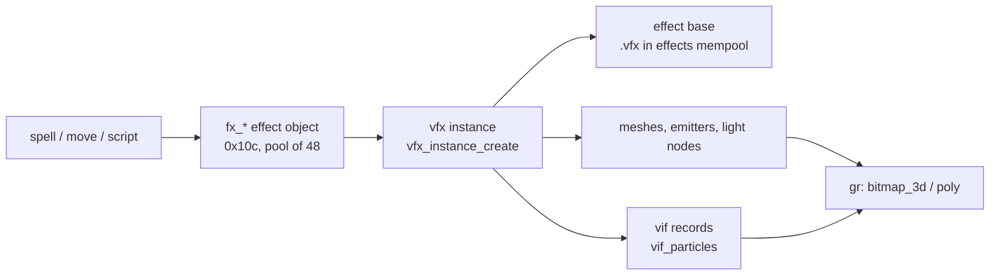

# Effects and lights

**Summary:** Visual effects have four layers. The game keeps up to 48 **effect objects** (`fx_*`, 0x10c bytes
each). Each one owns a **vfx instance** of an effect file (`.vfx`) loaded by `vsdk\geom`. A vfx file holds
meshes, particle emitters, dummies, forces, cameras, light nodes and **vif** particle records, all driven by
key tracks. Everything is drawn through `gr` sprites and polygons. Next to this sit 32 ground **decals**, a
list of **lamp glows**, and a 400-entry **light** table that lights characters, effect meshes and decals.
Level lights are rebuilt from the level file. Their ambient term is multiplied by `level_light_scale`,
which Luminar sets from his HP. All of this is **observed** in the disassembly unless marked otherwise.
Nothing here was checked in a running game.

See [vsdk: graphics](vsdk-gr.md) for the renderer and gr modes, [vsdk: character animation](vsdk-ca.md)
for bones and tags, [Combat](combat.md) and [Game tables](game-tables.md#spells) for spells, and
[Bosses](bosses.md) for the boss effects.

## Layer 1: game effect objects (`fx_*`)

- `fx_pool` (`0x2305bc0`) holds 48 effect objects of 0x10c bytes, built by `fx_pool_construct` (`0x489c90`).
  `fx_alloc` (`0x489ce0`) takes one from the free list. `fx_new` (`0x48c3e0`) links it into
  `fx_active_list` (`0x2305920`, next `+0x98`, prev `+0x9c`), sets the kind and the active bit. **Observed.**
- `fx_create_instance` (`0x48bdc0`) is the common creator. It calls `vfx_load`, stores the instance at `+0xa0`,
  and adds a lamp glow for every mesh with flag `0x40` (see below). **Observed.**
- `fx_frame` (`0x48a230`) updates every effect object each frame from `state_game_frame`. It runs status
  effects (`spell-status.vfx`, `stone-fade.vfx`), missiles, hits, sound emitters and `snow_update`. **Observed.**
- `fx_stop` (`0x48cf80`) deletes the sound and sets flag 4 of `+0x84`, so the effect ends on its own.
  `fx_destroy` (`0x48cfc0`) calls the virtual destroy `fx_obj_destroy` (`0x489dc0`) at once. **Observed.**
- An effect is finished when its instance has no time left. `fx_is_finished` (`0x48d000`) also returns the
  progress, 1 minus time left over the base length. **Observed.**

Known fields of `effect_object` (partial; `symbols/types.h`):

| Offset | Meaning | Evidence |
|---|---|---|
| `+0x10` / `+0x38` | position / orientation | **Observed** (`fx_create_instance`) |
| `+0x80` | handle (returned by the creators) | **Observed** |
| `+0x84` | flags: 1 active, 4 stopping, `0x40` paused for a cutscene, `0x200` | **Observed** |
| `+0xa0` | vfx instance | **Observed** |
| `+0xa4` | kind (see below) | **Observed** |
| `+0xa8` | spell index, -1 for none | **Observed** |
| `+0xac` / `+0xb4` | source handle / owner handle | **Observed** |
| `+0xc0` | target (`fx_set_target`) | **Observed** |
| `+0xdc`, `+0x104` | two GameTimers (built in `fx_obj__ctor`) | **Observed** |
| `+0xe0` | sound emitter handle, -1 for none | **Observed** |

Kinds set by the creators:

| Kind | Creator | Use |
|---|---|---|
| 2 | (`fx_set_target` `0x48cf50` only acts on objects whose type `+0xc` is 2) | *inferred*: cast effect that waits for a target; the check is on the object type `+0xc`, not the effect kind `+0xa4` (**observed**) |
| 3 | `fx_create_at_camera` `0x48c140` | cutscene effects at the camera |
| 4 | `fx_create_missile` `0x48c220` | projectiles; `fx_update_missile` `0x48b7a0` homes on the target bone |
| 7 | `fx_create_ground_effect` `0x48c540` | spell ground effects with a sound and timer |
| 9 / 10 | `fx_get_status_holder` `0x48cc60` | status effect holder / aura on a character |
| 0xb | `fx_create_spell_area` `0x48c630` | 1060 ms area that flags enemies within 10.0 |
| 0xc / 0xd / 0xe | `fx_create_spell_effect_near` / `_facing` / `_at` (`0x48c800` / `0x48c8a0` / `0x48cab0`) | a spell's hit effect near, facing or at a point |

The kind numbers come from the creators. Kind 1 and the other kinds were not traced. *Unknown.*

### Attachment to bones

`fx_attach_to_character` (`0x48c080`, 30 callers) creates the instance at the character. Then
`fx_bind_character_tags` (`0x48b690`) binds every vfx node except `"Scene Root"` to the character mesh tag
of the same name (`character_find_mesh_tag`, `vfx_instance__bind_node` `0x537580`). So an effect file
names its nodes after the bones or tags it follows. `fx_link_character` (`0x48d280`) also puts the effect
on one of 20 link nodes (`fx_char_link_used` `0x2308e18`). **Observed.** Particle emitters can follow a
bone too: `vfx_emitter_instance__get_transform` (`0x5612b0`) and `vif_emitter_update` (`0x532f40`) call
`character_instance__compute_bone_matrix`. **Observed.**

### Level changes and cutscenes

- `fx_level_leave` (`0x48a1d0`) and `fx_level_restart` (`0x48a200`) destroy all effects and release the
  level effect memory. **Observed.**
- `cutscene_play` pauses effects that are not part of the cutscene (`fx_pause_for_cutscene` `0x48d6d0`,
  base flag bit 26 via `effect_is_cutscene_base` `0x51dec0`) and destroys spell effects
  (`fx_destroy_spell_effects` `0x48d720`). `fx_resume_after_cutscene` (`0x48d770`) undoes the pause. **Observed.**
- `fx_create_world` (`0x48cea0`) is used by level-script traps. Effects whose name contains `sky` go in the
  5-entry `fx_sky_list` (`0x2318e2c`), which `levelrender_render_scene` draws first. **Observed.**

## How spells and moves spawn effects

- `spells.tbl` names the effects: `+Cast effect:` (`spell_info +0x0c`), `+Hit effect:` (`+0x1c`),
  `+Preloaded Hit effect:`, `+Misc effect:` and `+Banish effect:` (`+0x40`). The `fx_create_spell_effect_*`
  functions use the hit effect at `+0x1c`. **Observed** (`spells_parse_table` `0x47a190` stores).
- `character_perform_spell_cast` (`0x45da60`) plays the cast move and the cast effect
  (`spell_get_cast_effect` `0x47a870`). `spell_launch_missile` (`0x47e6c0`) finds the `$missile` tag of the
  caster (`vfx_instance__find_tag` `0x537f10`). **Observed.**
- `spell_cast_launch_effects` (`0x47d420`) is a 108-way switch on the spell. Its calls include
  `fx_set_target` (7), `spell_effect_add` (6), `spell_apply_hit_effects` (5), `fx_create_spell_effect_at`
  (3), and one each of `spell_fire_missile`, `spell_place_ground_effect`, `fx_create_spell_area`,
  `fx_create_spell_effect_near`, `fx_attach_to_character` and `spell_spawn_hit_fx`. **Observed.**
- `spell_effect_add` (`0x47f660`) keeps a 0x34-byte record in a pool of 64 (`spell_effects` `0x22e8528`).
  `fx_obj_destroy` frees it. **Observed.**
- Melee hits use fixed files: `combat_spawn_hit_vfx` (`0x4669c0`) plays `blood.vfx` or `sparkhit.vfx` /
  `sparkhit01.vfx`, and `combat_spawn_spark_vfx` (`0x466e90`) plays `sparkhit01.vfx`. **Observed.**
- Bosses and scripts name their own files, for example `LuminarBeam-source.vfx`, `Titus-RockErrupt.VFX`,
  `Mach-MeteorStorm.vfx`, `wc-trap1.vfx`. **Observed** (string references).

## Layer 2: effect files (`vsdk\geom`)

- `effects_load_bases` (`0x51cf60`) reads `effects.arr`. Each line gives a name and a category: `preload`,
  `cutscene`, `level`, `spell`, `character` or `summon` (`effects_parse_arr_line` `0x51ca60`). There are at
  most 192 base records of 20 bytes (`effect_bases` `0x2c8f060`): flags `+8` (bit 31 resident, bit 30
  streamed, bit 26 cutscene), data `+0xc`, name `+0x10`. **Observed.**
- Data lives in the `Effects` mempool (`effects_mem_buffer` `0x2731450`, 0x4c4c0 bytes) and a stream and
  cutscene area (`effects_stream_buffer` `0x277d910`). `preload.rfx` is loaded once by
  `effects_load_preload_rfx` (`0x51dbb0`); `rfx_preload` (`0x51bfd0`) refuses to run when it is too big.
  *Inferred:* an `.rfx` file is a bundle of effect bases read in one go.
- `vfx_load` (`0x51dd00`) loads by name. Names that start with `nar-`, `mi-` or `worl` are not level
  scoped. It calls `vfx_preload` then `vfx_instance_create` (`0x51d250`). **Observed.**
- After a read, `vfx_relocate` (`0x51c9f0`) and `vfx_node_relocate` (`0x536bc0`) turn the file's offsets into
  pointers. So a `.vfx` file is a memory image with a relocation table. **Observed.**
- Streaming: `effect_stream_queue_add` (`0x4404a0`) queues up to 100 entries of 0x34 bytes (name, target `+0x2c`,
  mempool `+0x30`). `effect_stream_open_current` (`0x4406d0`) starts one asynchronous read at a time and
  `effect_stream_update` (`0x4408a0`, from `GameTick` and `effect_base_load`) polls it. The branch is picked by the
  extension (`file_type_from_ext` `0x440650`): an `.rfx` base is read into its own buffer
  (`effect_base_alloc_stream_buffer`) from offset 0x14 and relocated by `effect_base_finish_stream`; `.mvf` and `.vim`
  files go through `effect_stream_buffer` (`0x60fe30`, 256 KB) to `skeleton_read` / `vim_load_file`. **Observed.**
  The only caller of `effect_stream_queue_add` is `effect_base_queue_stream` (`0x51c6a0`), which queues effect base
  names, so in v1.40 the `.mvf` / `.vim` branches run only if `effects.arr` names such a file (*inferred*; the
  retail list was not read for this). A `.peg` name starts a zero-byte read without opening a file. Decompiled as
  `src/decomp/game/unnamed_effectstream_0x440400.cpp` (placeholder name).

Parts of an effect base, from the relocation code:

| Base offset | Record | Size | Notes |
|---|---|---|---|
| `+0x20` | mesh | 0xa8 | vertices, faces, morphs, UV animation; flags `0x801` billboard, `0x40` lamp glow |
| `+0x28` | particle emitter | 0xe8 | rate channel `+0xdc`, fade in/out bytes `+0x2c`/`+0x2d` |
| `+0x2c` | vif particle desc | 0x21c | bitmap name `+0x70` |
| `+0x30` | dummy | 0x64 | position and orientation tracks |
| `+0x34` | force | 0xa0 | gravity, turbulence, collision plane |
| `+0x38` | camera | 0x64 | `vfx_get_camera` gives it to the game camera |
| `+0x3c` | group | 0x14 | list of 8-byte entries |
| `+0x44` | material | 0x4c | two texture layers and three byte curves |

Tracks are run-length coded `int16` key channels (`vfx_channel__eval` `0x55bc00`) read as fixed4, fixed8 or
fixed12 numbers. A vfx length is `(+0x24 + 1) * +0x20 / 4800` seconds, so time is in 1/4800 s ticks
(`vfx_get_length_seconds` `0x51e020`). Mesh frames run at 15 fps (`vfx_mesh_instance__update_frame`
`0x563a40`). **Observed.**

`vfx_instance_process` (`0x536fb0`) advances an instance. `vfx_instance_render` (`0x538260`) draws its emitters
and meshes. Effect meshes are lit by `lights_select_nearest` and `lights_shade_vertices` in `vfx_mesh_render`
(`0x562f60`). Emitters flagged full-bright (`0x10000`) ignore the ambient light. **Observed.**

## Layer 3: vif particles

- 100 vif records of 0xe8 bytes (`vif_records` `0x2d064e8`). The particle pool `vif_particles`
  (`0x2cbffe0`) has two halves of 3000 particles x 0x30 bytes. `vif_compact_particles` (`0x532a20`) copies
  the live particles into the other half and flips `vif_particle_half`. **Observed.**
- `vif_instantiate_level` (`0x5337a0`) gives each record its particles. It compacts when the 3000 limit is
  reached and prints "Skipping vif particle instantiation" when there is still no room. **Observed.**
- `vif_emitter_update` (`0x532f40`) spawns particles at a rate from `vif_curve__evaluate`, with the shape
  byte `+0xc0` choosing the spawn point. `vif_draw_particles` (`0x533620`) draws each one with
  `gr_bitmap_3d` and point fog. **Observed.**
- Records flagged `0x10` at `+0x68` are drawn late, after the sorted draw list, by
  `fx_draw_flagged_particles` (`0x487230`). **Observed.**

## Decals

- 32 decal records of 0x128 bytes (`0x2480a48`..`0x2482f48`), threaded by `decals_reset` (`0x4bc640`).
  `decal_place` (`0x4bc320`) takes a record through `decal_recycle`, starts a GameTimer and clips the decal
  to the level with `decal_build_clip_planes` (`0x4bbf10`). **Observed.** Which record it reuses when all
  32 are active was not traced. *Unknown.*
- Callers: `blood_splot_place` (`BloodSplot-large02/med02/small02.tga`), `move_target_draw_decal` (the
  click destination marker) and `place_ground_decal` (leader marker, ground pick). **Observed.**
- `decals_draw_for_lobj` (`0x4bc6b0`) draws them on each level object, lit by `lights_select_nearest`.
  `decals_recycle_unused` (`0x4bcc20`) frees expired ones each frame. **Observed.**

## Lamp glows

- `lamp_glow_load` (`0x4c0a60`) loads `WolongLampGlow01.tga` into `lamp_glow_bitmap` (`0x59db70`) and zeroes
  `lamp_glow_count` (`0x248b008`). **Observed.**
- Glows come from level objects (`levelrender_level_load`) and from effect meshes with flag `0x40`
  (`fx_create_instance`). `lamp_glow_add` (`0x4c0a90`) appends a 0x18-byte record with no bound check.
  The array has room for 300. **Observed** for the missing check; *inferred* for the size.
- `lamp_glows_draw` (`0x484380`) raycasts from each glow to the eye (`lobj_raycast`) and fades it in or out
  by frame time. `lamp_glow_draw` (`0x4c0b40`) draws a sprite scaled by its alpha. **Observed.**

## Lights

The `light` record is 0x94 bytes; 400 of them live at `lights` (`0x2ca5de0`). **Observed.**

| Offset | Field |
|---|---|
| `+0x00` / `+0x04` | next / prev in the active list (`light_list_head` `0x2cb4520`) |
| `+0x08` | flags: low bits type (2 point, 3 spot, 4 projected bitmap), bit 14 enabled, bit 15 dynamic |
| `+0x0c` / `+0x18` | position / spot direction |
| `+0x24`, `+0x28` | spot angles (degrees); `+0x60`, `+0x64` their negated cosines |
| `+0x2c`, `+0x30` | inner, outer radius; squares at `+0x58`, `+0x5c` |
| `+0x34`..`+0x3c` | colour times intensity |
| `+0x68` | projected bitmap (type 4) |
| `+0x90` | distance used for sorting |

- `light_create_point` (`0x51e290`) takes (position, inner, outer, intensity, r, g, b, dynamic).
  `light_create_spot` (`0x51e3f0`) adds a direction and angles. **Observed.**
- `lights_collect_enabled` (`0x51e910`) keeps lights with a type and bit 14. `lights_select_nearest`
  (`0x51e970`) pushes a selection level of the lights in range, sorted by distance, at most
  `lights_max_per_object` (2, 4 or 6 by detail level). Dynamic lights are skipped when
  `lights_dynamic_enabled` is 0. Callers are the three character mesh renderers, `vfx_mesh_render` and
  `decals_draw_for_lobj`. **Observed.**
- `lights_shade_point` (`0x51ec70`) adds distance falloff, the spot cone and projected bitmaps;
  `lights_shade_vertices` (`0x51f3b0`) adds the ambient `light_ambient_r/g/b`. **Observed.**

### Level lights and Luminar

- `level_lights_setup` (`0x48e520`) calls `light_reset_all`, sets the ambient from the level
  (`0xa5a374`..`0xa5a37c`) times `level_light_scale`, then makes one light per 0x4c-byte level record
  (count `0xa5a2e8`, array `0xa5a2ec`). Type 0 is a point light; types 1 and 4 are spot lights, with an
  optional projected level texture (`+0x48`). Intensity is `+0x2c` times `level_light_scale`. The range is
  20000.0 unless flag 2 of `+0x40` gives one. **Observed.**
- It runs at level load and from `levelrender_render_scene` when the byte `0x243e038` is set. No code that
  sets that byte was found. *Unknown.*
- `luminar_ai_select_action` (`0x4c9410`) stores Luminar's HP fraction in `level_light_scale` (`0x59c358`);
  `luminar_free_bitmap` resets it to 1.0. *Inferred:* the level gets darker as Luminar is hurt, but only
  when the lights are rebuilt.
- `ui_3d_begin` (`0x412400`) lights the inventory model with `inv-lights1.vfx` and restores the state in
  `ui_3d_end`. **Observed.**

### Character and effect light sources (`attached_light_slots`)

The 24 records of 0x98 bytes at `0x2cb45d0` are moving point lights attached to characters and effect
nodes.

{: .important }
Until 2026-10-14 this family was named `shadow_*` (`shadow_slots`, `shadow_create`, `vfx_node_create_shadow`,
...). They are lights, so they are now `attached_light_*` and `vfx_light_desc__*`. The blob shadows keep the
`shadow` names.

**Observed:**

- `living_entity_init` calls `attached_light_create` (`0x520160`) with a bone position, colour from
  `char_info +0x248..+0x250` and `+LightAtten:` (`+0x254`). Effect light nodes do the same through
  `vfx_node_create_light` and `attached_light_create_from_vfx`.
- Each frame `levelrender_setup_level_lights` (`0x482d70`) turns every used slot (`level_light_get`
  `0x48d180`) into a dynamic `light_create_point`. `levelrender_rank_light` (`0x4863b0`) ranks the same
  records for level objects.
- The blob shadows (`Shadow01.tga`, `shadow_collect_for_lobj`, table `0x245ce8c`) are a separate system.

## Other

- Snow: `snow_start` (`0x494ab0`) for a few levels, a 15 x 15 grid of flake cells, drawn by `snow_render`.
- The console command `show_effect_mem` prints effect memory use.

## Open questions

- Kinds 1, 5, 6 and 8 of effect objects, and the full `fx_frame` switch.
- The layout of a `.vfx` file header and of `.rfx` bundles (no files were read).
- Who sets the light rebuild byte `0x243e038`.
- The field names of `char_info +0x248..+0x250` (light colour is *inferred*).

## Evidence

This page lists function addresses instead of REA evidence ids.

| Claim | Where |
|---|---|
| effect object pool, kinds, active list | `fx_pool_construct` `0x489c90`, `fx_new` `0x48c3e0`, `fx_obj__ctor` `0x489d30` |
| lamp glow for mesh flag `0x40` | `fx_create_instance` `0x48bea4`..`0x48bec0` |
| bind to mesh tags except "Scene Root" | `fx_bind_character_tags` `0x48b690` |
| spell effect fields | `spells_parse_table` `0x47a2c0`..`0x47a397` |
| launch switch callees | `spell_cast_launch_effects` `0x47d420` |
| `effects.arr` categories | `effects_parse_arr_line` `0x51ca60` |
| 1/4800 s ticks | `vfx_get_length_seconds` `0x51e020` |
| 3000-particle halves | `vif_instantiate_level` `0x53384b`, `vif_compact_particles` `0x532a20` |
| late particle pass | `fx_draw_flagged_particles` `0x487230`, called at `0x4825af` |
| decal records and callers | `decals_reset` `0x4bc640`, `decal_place` `0x4bc320` |
| lamp glow add without bound | `lamp_glow_add` `0x4c0a90` |
| light record and point light args | `light_create_point` `0x51e290` |
| level lights and `level_light_scale` | `level_lights_setup` `0x48e528`..`0x48e69f` |
| rebuild gate `0x243e038` | `levelrender_render_scene` `0x48236a` |
| Luminar HP fraction | `luminar_ai_select_action` `0x4c9419`..`0x4c9435` |
| slot lights from characters | `living_entity_init` `0x44ecf6`, `attached_light_create` `0x520160`, `levelrender_setup_level_lights` `0x482db4`..`0x482ded` |
