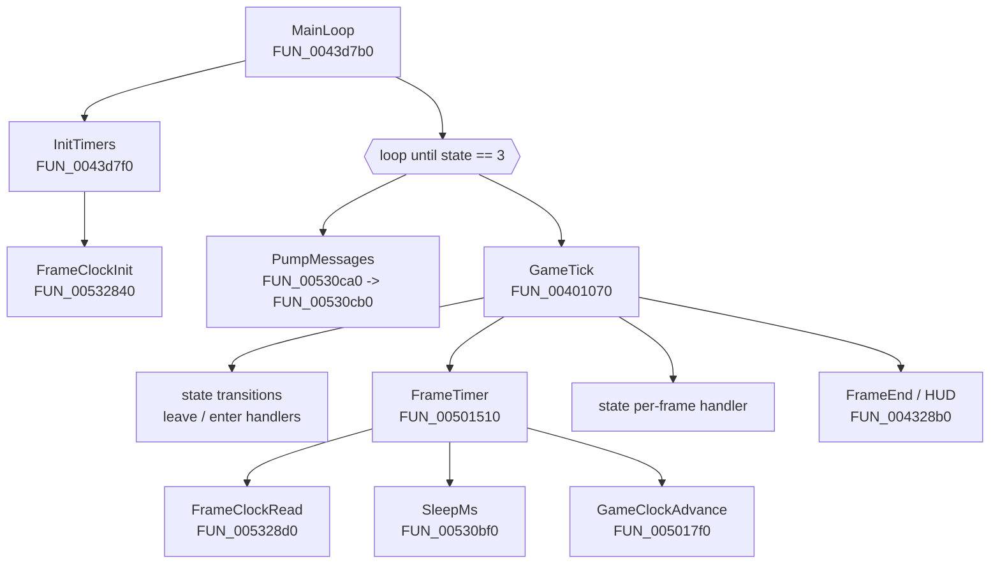
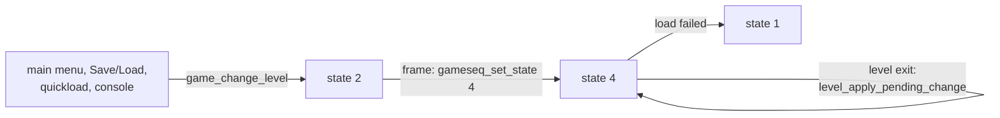

# Main loop and frame timer
{: .no_toc }

1. TOC
{:toc}

**Summary:** Summoner uses a **variable timestep**. Each frame it measures real elapsed
time with QueryPerformanceCounter, sleeps if the frame was shorter than 1/120 s, caps the
step at 0.25 s, and passes the result to gameplay as the frame time. There is no
fixed-rate simulation step.

## Call structure



## Outer loop: `MainLoop` (`FUN_0043d7b0`)

**Observed.**

```c
atexit(&cleanup_00512590);
InitTimers();                  // FUN_0043d7f0 - calls FrameClockInit and other setup
GameInit();                    // FUN_0043df40
do {
    PumpMessages();            // FUN_00530ca0
    state = GameTick();        // FUN_00401070
} while (state != 3);          // state 3 = quit
Shutdown();                    // FUN_0043e1f0, FUN_0043df20
```

`PumpMessages` (`FUN_00530cb0`) loops `PeekMessageA(..., PM_REMOVE)` followed by
`TranslateMessage` and `DispatchMessageA` until the queue is empty. It never blocks, so
the loop runs as fast as the frame limiter allows.

## One frame: `GameTick` (`FUN_00401070`)

**Observed**, except where marked.

1. **Pending state transitions.** While `state_change_pending` (`0x5b27ec`) is set:
   - call the old state's *leave* handler (`state_table[cur].leave`);
   - `StateSwap` (`FUN_00401190`): `prev = cur; cur = next; pending = 0`;
   - clear two per-frame flags (`FUN_004138a0`, `FUN_00414020`);
   - call the new state's *enter* handler.
2. **Frame timer.** If `0x2491a5c == 1`, set `frame_dt = 0` (frozen). Otherwise call
   `FrameTimer`. *Inferred:* the flag is pause or cutscene freeze.
3. `mouse_update` (`0x500a90`), then `mouse_get_pos` (`0x5011e0`) into `game_mouse_x`, `game_mouse_y` and
   `game_mouse_z` (`0x5fbfdc`, `0x5fbfe0`, `0x257ef80`).
4. In multiplayer (`game_flags` bit `0x2` at `0x5fbfd8`, set by `state_title_enter`; not a debug flag): clear
   the per-type packet counters and run `multi_do_frame` (`0x4413d0`). Then `effect_stream_update` (`0x4408a0`)
   when `effect_stream_state` (`0x65139c`) is 1.
5. **The state's per-frame handler** (`state_table[cur].frame`). This is where gameplay
   runs, using `frame_dt`.
6. In multiplayer, one "Packet type %d created %d time(s)" line per used packet type is formatted into
   `string_buffer` and never shown (`0x40113d`..`0x401173`). Then `editor_dialogs_free_closed` (`0x431640`,
   frees the script editor's closed message boxes) and `FrameEnd` (`0x4328b0`). `FrameEnd` draws
   `game_status_message` while its timer runs (nothing in v1.40 sets either, so it never shows), the
   `FPS=%3.1f` counter when `show_framerate` is on and no screen is open (`interface_get_screen() == 0`), and
   the `gr_info` render statistics, which never appear because nothing adds to `gr_info_total_time`
   (`0x2396c90`). It then draws the mouse cursor when `cursor_visible` (`0x5fc01c`) is set and the cutscene
   loading icon in state 4, saves the screenshot that Print Screen requested (`game_flags` `0x40`), calls
   `gr_flip` (`0x506a20`) unless `game_flags` bit `0x8000` is set (the bit is then cleared), and ends with
   `snd_do_frame` (`0x432d48`). **Observed.**
7. Return `cur` state to `MainLoop`.

### Game-state table (`0x588a70`)

Each entry is 12 bytes: `{ enter, frame, leave }`.

| State | enter | frame | leave | Notes |
|---|---|---|---|---|
| 0 | - | - | - | empty |
| 1 | `0x431c60` | `0x431e00` | `0x431df0` | Boot: opens the main menu; also the fallback when a level or a save fails to load |
| 2 | `0x431e20` | `0x431e70` | `0x4f13e0` | Level change from outside a level (new game, load, quickload, console); frame goes straight to state 4 |
| 3 | - | - | - | quit; ends `MainLoop` |
| 4 | `0x438130` | `0x438f30` | `0x438c80` | In-game: level load on enter, gameplay frame, level unload on leave; `FrameEnd` special-cases state 4 |
| 5 | `0x43a2b0` | `0x43a2e0` | `0x43a300` | In-game help screen ("Summoner Help"), not a loading screen; **never entered** in v1.40 |
| 6 | `0x43fb60` | `0x43fc80` | `0x43fc70` | Monster layout editor table; frame sleeps with `timer_wait`; **never entered** |
| 7 | `0x430ad0` | `0x430b20` | `0x430b10` | Debug help text (centred message); **never entered** |
| 8 | `0x431e80` | `0x432370` | `0x4323d0` | Debug "Load" screen (level and script list boxes); **never entered** |
| 9 | `0x430b80` | `0x430b90` | `0x4f13e0` | Credits (screen 21) |
| 10 | `0x43f9c0` | `0x43ed90` | `0x4f13e0` | Multiplayer character select (screen 16) |
| 11 | `0x43eff0` | `0x43f080` | `0x43f740` | Multiplayer PXO lobby (screen 11) |
| 12 | `0x43eed0` | `0x43eef0` | `0x43ef20` | Multiplayer game list (screen 15) |
| 13 | `0x43ed80` | `0x43ed90` | `0x4f13e0` | Multiplayer game creation (screen 17) |
| 14 | `0x43eb00` | `0x43eb30` | `0x43eb60` | Multiplayer screen 18 |

There are **15** states (read 2026-10-13). State 1 (boot) opens the main menu (screen 14).
States 10-14 belong to the [multiplayer code](source-map.md#more-file-names-from-stringstbl).
`0x4f13e0` is a bare `ret`, shared by several leave handlers and by the `charinfo` console
command (a stub in retail). Ghidra did not mark these handlers as functions;
`tools/disasm.mjs` reads them. The menu screens are listed on the
[Interface](interface.md) page.

**Which states are reachable (observed).** `gameseq_set_state` (`0x401020`) has 54 call sites, and
the raw `E8` scan of `.text` finds no other. Their arguments are 1, 2, 3, 4, 9, 10-14, the previous
state (state 7's frame, `0x430b35`) and the saved return state (state 5's key handler, `0x43a192`).
Nothing writes the next-state variable (`0x5b27e8`) except `gameseq_set_state` and the reset at
`0x401000`, and no table holds a pointer to `0x401020`. So **states 5, 6, 7 and 8 are never entered** in
v1.40. Their handlers are left-over debug screens. `state_game_leave` and `state_game_enter` still
keep the level when the next or previous state is 5 or 6; that branch is dead too.

### Level changes and state 4 (observed)



- **`game_change_level`** (`0x431a40`) clears `level_prev_filename`, sets `level_entry_point` to 1, copies the
  level name and the script name (for a NULL script: the level's first `conversation_save_table` name, or the
  level name) and always sets state 2. It sets `level_entered_by_load` when a save is pending, or when the
  level is `masad` (`level_script_find` index 3) with script `masad`, and sets the byte `0x5fbf18`, which
  nothing reads, when it runs before the first state (`0x431a57`..`0x431b62`).
  Its callers are `mainmenu_start_new_game` (level 3, `masad`), `saveload_load_selected`, `quickload`,
  `cmd_loadgame`, `cutscene_change_level_for` (console), `mp_change_level` and the unreachable state 8.
- **State 2 enter** (`state_title_enter`, `0x431e20`) plays the "Title" music, resets the objects, the
  party inventory (30 gold, no items) and the item types, and sets `game_flags` to
  `(game_flags & 0x1c) | 1` (single player), or `| 2` (multiplayer) when the previous state was 14.
  This runs on a load too; the save then restores the state.
- **A level exit in single player** sets state 4 while in state 4 (`level_apply_pending_change`,
  `0x4ccde5`). State 4's leave and enter both run, with previous and next state 4.
- **State 4 enter** (`state_game_enter`, `0x438130`): previous state 2 or 14 is a new start (AI groups,
  party inventory and `level_time` reset, camera to the default view); 5 or 6 returns at once; any other
  keeps the party. Then `level_load` (`0x438570`, with the loading screen), the pending savegame or the
  automap labels, `level_script_init`, the party placement, the conversation, `game_pause_count_dec`,
  `game_flags |= 0x200` and `&= ~0x40000`, the level visit count, `interface_load_all`.
  If `level_load` or `savegame_load_pending` fails, single player goes to state 1 (`0x438211`) and
  multiplayer reports the local player as disconnected (`0x4381cc`); only these failure paths set
  `state_game_load_failed` (`0x609f58`, `0x43821b`; formerly `state_game_level_ready`, a wrong name).
- **State 4 leave** (`state_game_leave`, `0x438c80`): unless the next state is 5 or 6, it frees the
  containers and level items, saves the conversation state (only after a good load), stops all sounds,
  runs `level_script_leave` and `level_unload` (`0x437e00`). `level_unload` resets the party
  (`party_level_reset`): a next state other than 4 removes the whole party, a level change keeps it
  and revives it only when the new level is a town or the world map ([Party](party.md#death)). After a
  good load it calls `game_pause_count_inc`, the counterpart of the enter's decrement. It clears
  `game_flags` `0x100`, `0x200` and `0x40000`, and turns solo mode off.

## Frame timer: `FrameTimer` (`FUN_00501510`)

**Observed** in both the decompiled code and the assembly.

```c
if (!timer_initialised) FrameTimerInit();              // FUN_005014b0
if (timer_frozen /*0x257f0a4*/) return;

now = FrameClockRead(1000000);                         // microseconds
if (now < last) raw = (now < 0) ? frame_dt * 1e6 : now; // backwards-clock guard
else            raw = now - last;
last = now;
dt = raw * 1e-6;                                       // seconds

if (dt < MIN_DT) {                                     // 1/120 s
    Sleep((int)((MIN_DT - dt) * 1000.0f));             // truncated to whole ms
    dt = MIN_DT;
} else if (dt > MAX_DT) {                              // 0.25 s
    dt = MAX_DT;
}

ring[i] = dt; sum += dt - old; i = (i + 1) & 15;       // 16-frame window
fps = (frames < 16) ? frames / sum : 16.0f / sum;      // shown by FPS=%3.1f
frame_dt = dt / time_scale;                            // time_scale is always 1.0
frames++;
ms = (int)(frame_dt * 1000.0f);
GameClockAdvance(ms);                                  // FUN_005017f0
if (!total_paused /*0x257f0a8*/) total_ms += ms;       // 0x257f08c
```

### Timer globals

| Address | Label | Initial value | Meaning |
|---|---|---|---|
| `0x5a573c` | `raw_dt` | 1/30 | Last measured frame time, seconds |
| `0x5a5740` | `frame_dt` | 1/30 | Frame time used by gameplay; read at 80+ sites |
| `0x5a5744` | `fps_avg` | 30.0 | 16-frame average FPS |
| `0x5a5748` | `time_scale` | 1.0 | Divides `frame_dt`; only ever written by `FrameTimerInit` |
| `0x5a574c` | `MIN_DT` | 1/120 | Frame-time floor; set by `FUN_005016f0` |
| `0x5a5750` | `MAX_DT` | 0.25 | Frame-time ceiling; set by `FUN_005016f0` |
| `0x5a5754` | `ring_index` | -1 | -1 means "reset the window" |
| `0x257f040` | `ring[16]` | 0 | Last 16 frame times |
| `0x257f088` | `frames` | 0 | Frame count |
| `0x257f098` | `last` | 0 | Previous clock reading, microseconds |

Float constants: `0x581d20` = 1e-6, `0x581d24` = 1e6, `0x57ef28` = 1000.0,
`0x580df0` = 16.0.

### Game clocks: `GameClockAdvance` (`FUN_005017f0`)

Adds `ms` to two millisecond counters that wrap at `0x3ff1a100` (1,072,800,000 ms,
about 12.4 days):

- `0x5a5758`: skipped while `0x257f0ac` is set (*inferred:* pause-aware game clock);
- `0x5a575c`: always advances.

## Frame clock: `FrameClockInit` / `FrameClockRead`

**Observed.**

`FrameClockInit` (`FUN_00532840`) runs once:

1. `QueryPerformanceFrequency` - stores **only the low 32 bits** at `0x2cbffdc`
   (see [the >4 GHz bug](timing-bugs.md#1-qpc-frequency-truncation-4-ghz-bug));
2. `QueryPerformanceCounter` into both `base` (`0x2cbffd0`) and `last` (`0x2cbffa8`);
3. initialises a critical section (`0x2cbffb8`);
4. measures RDTSC across two `Sleep(250)` calls and stores half the difference at
   `0x2cbffb0`. **That value is never read again.**

`FrameClockRead(scale)` (`FUN_005328d0`) returns
`(QPC_now - base) * scale / freq_low32` as a 32-bit integer, inside the critical section.
If the counter goes backwards it resets `base`. The 64-bit product is reduced with a
subtract loop on the high word before `DIV`, so the result wraps instead of faulting.

{: .note }
With `scale = 1000000` the 32-bit result is a microsecond count that `FrameTimer`
compares as **signed** (`CMP ESI, EAX` / `JGE` at `0x501548`). When the count crosses
2^31 µs (about 35.8 minutes after `FrameClockInit`, then every 71.6 minutes), the
reading looks negative and smaller than the previous one. The backwards-clock guard then
reuses the previous `frame_dt` for that one frame. The full 2^32 wrap is seamless,
because the subtraction is modular. *Inferred* from the assembly; not tested.

### Supporting timing setup

- `FUN_00566cf0` calls `timeBeginPeriod(1)`, so `Sleep` has about 1 ms granularity.
- `SleepMs` (`FUN_00530bf0`) is a thin `Sleep` wrapper.

## Behaviour implications

**Inferred** from the code above.

- **Above 120 FPS**, the leftover time is slept off. Because the sleep length is
  truncated to whole milliseconds, the real cap sits slightly above 120 FPS.
- **Below 4 FPS** (frames longer than 0.25 s), game time runs slower than real time.
- **In between**, everything scales with the measured `frame_dt`. Results can vary
  slightly with frame rate, because the step size changes.
- The sleep happens after the clock was read, so the slept time is counted in the next
  frame's measurement.

{: .important }
**Correction (observed 2026-10-12):** this double-counting makes the game run at **2x speed**
on any PC whose frames are much shorter than 1/120 s. See
[Timing bugs](timing-bugs.md#3-frame-limiter-double-counts-its-sleep-2x-game-speed).

## Other timers (not yet analysed)

- `cutscene_sequence_update` (`0x436a90`), `cutscene_events_frame` (`0x436c00`) and
  `cutscene_camera_sequence_sample` (`0x494310`): the `timeGetTime` shot clock of the
  [cutscenes](cutscenes.md#shots-timing-and-events). See
  [the cutscene bug](timing-bugs.md#2-cutscene-timer-sign-bug-249-day-uptime).
- `FUN_00566560`: a `timeSetEvent` multimedia timer, probably audio.
- `FUN_0053171f`: system info dump (CPU type, speed, RAM); it times a memory copy.

## Evidence

| Claim | REA evidence ID or address (`tools/asm.mjs`) |
|---|---|
| `MainLoop` pseudocode | `ev_a63ff74605b37d2977eb826bc221a85e122eba85a12bfbbdede9d04b4636257a` |
| `GameTick` pseudocode | `ev_5162c28f5149888a1c314487cb3e1d72ae5f3093fa97a1185f39609f5b3dcd99` |
| `FrameTimer` pseudocode | `ev_517107b177d15931bd6c97b8fdc04723b02b2a2e4a34c71814dd7240da7bbaf0` |
| `FrameTimer` assembly | `ev_c766aaa8b43f107d3fc77b636ce136044a3ced6f77bddd93d4a7f04d3b47e1bb` |
| `FrameTimerInit` constants | `ev_c9973c5d2ef9a827b581da3d8b270b1b5cc8c8e847f3913dd998e1884f40bb9b` |
| State table bytes | `ev_9616c1b41de02d17a7d58676d24dacf44456b2e38e1ee78c2b97b60d481c9b7c` |
| `FrameClockRead` assembly | `ev_2a63b0c40da8d738c1d8775fb3148f6fe942bfb42cf521d23133078825a5ba25` |
| States 5-8 never entered | `gameseq_set_state` call sites (54, listed with `tools/asm.mjs callers 0x401020`); writers of `0x5b27e8` at `0x40100c`, `0x40102b` |
| Level change through state 2 | `game_change_level` `0x431a40`..`0x431b4e`; `state_title_enter` `0x431e20`..`0x431e63`; `state_title_frame` `0x431e70` |
| Level exit 4 to 4 | `level_apply_pending_change` `0x4ccd2d`..`0x4ccde5` |
| State 4 enter | `state_game_enter` `0x438130`..`0x438551`, jump table `0x438554` / index bytes `0x438560` |
| Load-failed flag | `state_game_enter` `0x438132`, `0x4381c8`..`0x43821b`; `state_game_leave` `0x438cb8`, `0x438d2e` |
| State 4 leave | `state_game_leave` `0x438c80`..`0x438d55`; `level_unload` `0x437e00` |
| Help screen | `state_help_enter` `0x43a2b0`, `state_help_frame` `0x43a2e0`, `state_help_leave` `0x43a300`, `help_draw_page` `0x43a0a0` |

## Changes (2026-10-15, gameplay.cpp)

{: .important }
Checked against the disassembly of `gameplay.cpp` (`src/decomp/game/gameplay.cpp`). State 5 is the in-game
help screen ("Summoner Help", one page of mouse, keyboard and camera controls, Esc returns to the saved state),
not a loading screen. The level loads inside state 4's enter handler, behind the loading-screen progress bar.
States 5, 6, 7 and 8 have no `gameseq_set_state` caller and are never entered in v1.40. State 2 is the
level-change state for new games and loads (normal level exits go from state 4 to state 4). States 1, 2 and 4
now have **observed** descriptions. `state_game_load_failed` (formerly `state_game_level_ready`) is set only when the load fails.
