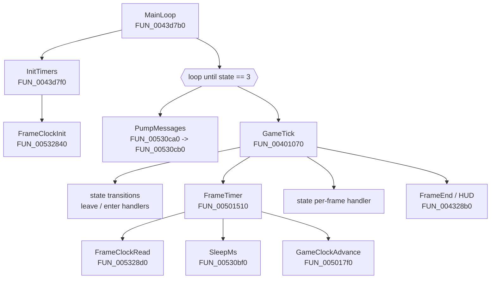

# Main loop and frame timer
{: .no_toc }

1. TOC
{:toc}

**Summary:** Summoner uses a **variable timestep**. Each frame it measures real elapsed
time with QueryPerformanceCounter, sleeps if the frame was shorter than 1/120 s, caps the
step at 0.25 s, and passes the result to gameplay as the frame time. There is no
fixed-rate simulation step.

## Call structure



## Outer loop: `MainLoop` (`FUN_0043d7b0`)

**Observed.**

```c
atexit(&cleanup_00512590);
InitTimers();                  // FUN_0043d7f0 - calls FrameClockInit and other setup
GameInit();                    // FUN_0043df40
do {
    PumpMessages();            // FUN_00530ca0
    state = GameTick();        // FUN_00401070
} while (state != 3);          // state 3 = quit
Shutdown();                    // FUN_0043e1f0, FUN_0043df20
```

`PumpMessages` (`FUN_00530cb0`) loops `PeekMessageA(..., PM_REMOVE)` followed by
`TranslateMessage` and `DispatchMessageA` until the queue is empty. It never blocks, so
the loop runs as fast as the frame limiter allows.

## One frame: `GameTick` (`FUN_00401070`)

**Observed**, except where marked.

1. **Pending state transitions.** While `state_change_pending` (`0x5b27ec`) is set:
   - call the old state's *leave* handler (`state_table[cur].leave`);
   - `StateSwap` (`FUN_00401190`): `prev = cur; cur = next; pending = 0`;
   - clear two per-frame flags (`FUN_004138a0`, `FUN_00414020`);
   - call the new state's *enter* handler.
2. **Frame timer.** If `0x2491a5c == 1`, set `frame_dt = 0` (frozen). Otherwise call
   `FrameTimer`. *Inferred:* the flag is pause or cutscene freeze.
3. `FUN_00500a90` and `FUN_005011e0` (*inferred:* input and cursor).
4. Multiplayer packet statistics, if debug flag bit 1 of `0x5fbfd8` is set.
5. **The state's per-frame handler** (`state_table[cur].frame`). This is where gameplay
   runs, using `frame_dt`.
6. `FUN_00431640`, then `FrameEnd` (`FUN_004328b0`): screenshot message, the
   `FPS=%3.1f` counter when `show_framerate` is on, render statistics, then
   *inferred* buffer flip (`FUN_00506a20`).
7. Return `cur` state to `MainLoop`.

### Game-state table (`0x588a70`)

Each entry is 12 bytes: `{ enter, frame, leave }`.

| State | enter | frame | leave | Notes |
|---|---|---|---|---|
| 0 | - | - | - | empty |
| 1 | `0x431c60` | `0x431e00` | `0x431df0` | |
| 2 | `0x431e20` | `0x431e70` | `0x4f13e0` | |
| 3 | - | - | - | quit; ends `MainLoop` |
| 4 | `0x438130` | `0x438f30` | `0x438c80` | *Inferred* in-game; `FrameEnd` special-cases state 4 |
| 5 | `0x43a2b0` | `0x43a2e0` | `0x43a300` | |

Only the first six entries were read. Whether the table has more is **unknown**.

## Frame timer: `FrameTimer` (`FUN_00501510`)

**Observed** in both the decompiled code and the assembly.

```c
if (!timer_initialised) FrameTimerInit();              // FUN_005014b0
if (timer_frozen /*0x257f0a4*/) return;

now = FrameClockRead(1000000);                         // microseconds
if (now < last) raw = (now < 0) ? frame_dt * 1e6 : now; // backwards-clock guard
else            raw = now - last;
last = now;
dt = raw * 1e-6;                                       // seconds

if (dt < MIN_DT) {                                     // 1/120 s
    Sleep((int)((MIN_DT - dt) * 1000.0f));             // truncated to whole ms
    dt = MIN_DT;
} else if (dt > MAX_DT) {                              // 0.25 s
    dt = MAX_DT;
}

ring[i] = dt; sum += dt - old; i = (i + 1) & 15;       // 16-frame window
fps = (frames < 16) ? frames / sum : 16.0f / sum;      // shown by FPS=%3.1f
frame_dt = dt / time_scale;                            // time_scale is always 1.0
frames++;
ms = (int)(frame_dt * 1000.0f);
GameClockAdvance(ms);                                  // FUN_005017f0
if (!total_paused /*0x257f0a8*/) total_ms += ms;       // 0x257f08c
```

### Timer globals

| Address | Label | Initial value | Meaning |
|---|---|---|---|
| `0x5a573c` | `raw_dt` | 1/30 | Last measured frame time, seconds |
| `0x5a5740` | `frame_dt` | 1/30 | Frame time used by gameplay; read at 80+ sites |
| `0x5a5744` | `fps_avg` | 30.0 | 16-frame average FPS |
| `0x5a5748` | `time_scale` | 1.0 | Divides `frame_dt`; only ever written by `FrameTimerInit` |
| `0x5a574c` | `MIN_DT` | 1/120 | Frame-time floor; set by `FUN_005016f0` |
| `0x5a5750` | `MAX_DT` | 0.25 | Frame-time ceiling; set by `FUN_005016f0` |
| `0x5a5754` | `ring_index` | -1 | -1 means "reset the window" |
| `0x257f040` | `ring[16]` | 0 | Last 16 frame times |
| `0x257f088` | `frames` | 0 | Frame count |
| `0x257f098` | `last` | 0 | Previous clock reading, microseconds |

Float constants: `0x581d20` = 1e-6, `0x581d24` = 1e6, `0x57ef28` = 1000.0,
`0x580df0` = 16.0.

### Game clocks: `GameClockAdvance` (`FUN_005017f0`)

Adds `ms` to two millisecond counters that wrap at `0x3ff1a100` (1,072,800,000 ms,
about 12.4 days):

- `0x5a5758`: skipped while `0x257f0ac` is set (*inferred:* pause-aware game clock);
- `0x5a575c`: always advances.

## Frame clock: `FrameClockInit` / `FrameClockRead`

**Observed.**

`FrameClockInit` (`FUN_00532840`) runs once:

1. `QueryPerformanceFrequency` - stores **only the low 32 bits** at `0x2cbffdc`
   (see [the >4 GHz bug](timing-bugs.md#1-qpc-frequency-truncation-4-ghz-bug));
2. `QueryPerformanceCounter` into both `base` (`0x2cbffd0`) and `last` (`0x2cbffa8`);
3. initialises a critical section (`0x2cbffb8`);
4. measures RDTSC across two `Sleep(250)` calls and stores half the difference at
   `0x2cbffb0`. **That value is never read again.**

`FrameClockRead(scale)` (`FUN_005328d0`) returns
`(QPC_now - base) * scale / freq_low32` as a 32-bit integer, inside the critical section.
If the counter goes backwards it resets `base`. The 64-bit product is reduced with a
subtract loop on the high word before `DIV`, so the result wraps instead of faulting.

{: .note }
With `scale = 1000000` the 32-bit result is a microsecond count that `FrameTimer`
compares as **signed** (`CMP ESI, EAX` / `JGE` at `0x501548`). When the count crosses
2^31 µs (about 35.8 minutes after `FrameClockInit`, then every 71.6 minutes), the
reading looks negative and smaller than the previous one. The backwards-clock guard then
reuses the previous `frame_dt` for that one frame. The full 2^32 wrap is seamless,
because the subtraction is modular. *Inferred* from the assembly; not tested.

### Supporting timing setup

- `FUN_00566cf0` calls `timeBeginPeriod(1)`, so `Sleep` has about 1 ms granularity.
- `SleepMs` (`FUN_00530bf0`) is a thin `Sleep` wrapper.

## Behaviour implications

**Inferred** from the code above.

- **Above 120 FPS**, the leftover time is slept off. Because the sleep length is
  truncated to whole milliseconds, the real cap sits slightly above 120 FPS.
- **Below 4 FPS** (frames longer than 0.25 s), game time runs slower than real time.
- **In between**, everything scales with the measured `frame_dt`. Results can vary
  slightly with frame rate, because the step size changes.
- The sleep happens after the clock was read, so the slept time is counted in the next
  frame's measurement.

{: .important }
**Correction (observed 2026-10-12):** this double-counting makes the game run at **2x speed**
on any PC whose frames are much shorter than 1/120 s. See
[Timing bugs](timing-bugs.md#3-frame-limiter-double-counts-its-sleep-2x-game-speed).

## Other timers (not yet analysed)

- `FUN_00436a90` (and `0x436c00`, `0x494310`): a `timeGetTime`-based sequence timer,
  probably for cutscenes or scripted events. See
  [the cutscene bug](timing-bugs.md#2-cutscene-timer-sign-bug-249-day-uptime).
- `FUN_00566560`: a `timeSetEvent` multimedia timer, probably audio.
- `FUN_0053171f`: system info dump (CPU type, speed, RAM); it times a memory copy.

## Evidence

| Claim | REA evidence ID |
|---|---|
| `MainLoop` pseudocode | `ev_a63ff74605b37d2977eb826bc221a85e122eba85a12bfbbdede9d04b4636257a` |
| `GameTick` pseudocode | `ev_5162c28f5149888a1c314487cb3e1d72ae5f3093fa97a1185f39609f5b3dcd99` |
| `FrameTimer` pseudocode | `ev_517107b177d15931bd6c97b8fdc04723b02b2a2e4a34c71814dd7240da7bbaf0` |
| `FrameTimer` assembly | `ev_c766aaa8b43f107d3fc77b636ce136044a3ced6f77bddd93d4a7f04d3b47e1bb` |
| `FrameTimerInit` constants | `ev_c9973c5d2ef9a827b581da3d8b270b1b5cc8c8e847f3913dd998e1884f40bb9b` |
| State table bytes | `ev_9616c1b41de02d17a7d58676d24dacf44456b2e38e1ee78c2b97b60d481c9b7c` |
| `FrameClockRead` assembly | `ev_2a63b0c40da8d738c1d8775fb3148f6fe942bfb42cf521d23133078825a5ba25` |
