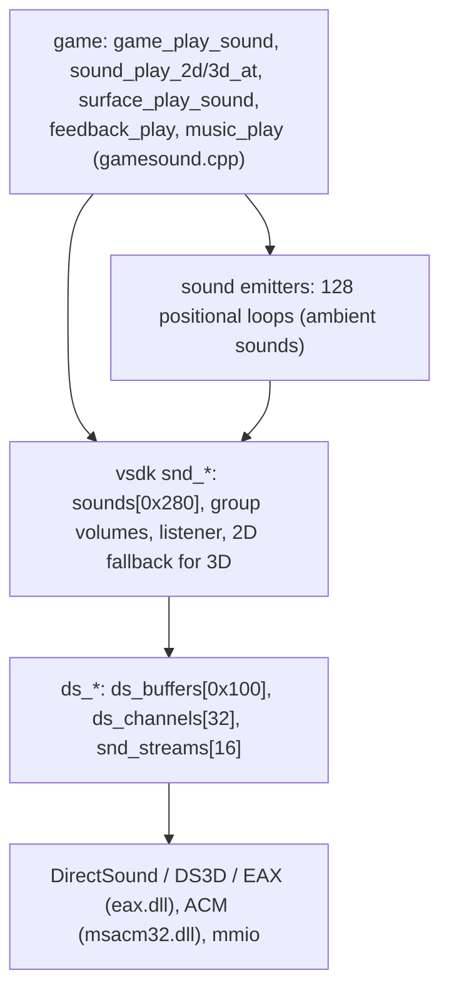

# Sound and music
{: .no_toc }

1. TOC
{:toc}

**Summary:** Sound in Sum.exe has three layers. The game layer (`gamesound.cpp`) plays sounds
and music by table index. The vsdk `snd_*` layer keeps a 640-entry sound table, group
volumes and the listener. The DirectSound `ds_*` layer owns 256 buffers, 32 channels and 16
streams; it adds DirectSound3D and EAX 2 when asked. Music is a streamed `.wav` that level
scripts pick by name from `music.tbl`. Compressed files are MS-ADPCM, decoded through ACM.

{: .note }
Function names are our labels from `symbols/sum.symbols`. The evidence table at the end lists
function addresses, not REA evidence ids. Written 2026-10-14 from the disassembly (agent draft, key claims
re-checked).

## Layers



| Layer | Main entry points | Notes |
|---|---|---|
| Game | `game_play_sound` (`0x468d90`), `sound_play_2d` (`0x468dc0`), `sound_play_3d_at` (`0x468de0`), `surface_play_sound` (`0x468e00`), `feedback_play` (`0x469720`), `music_play` (`0x469080`) | 75 callers of `game_play_sound`, mostly interface clicks (**observed**) |
| Emitters | `sound_create_emitter` (`0x5466f0`), `sound_emitter_play` (`0x546320`), `sound_emitter_update_position` (`0x5468c0`) | 128 records of 0x74 bytes at `0x2f07768` (**observed**) |
| vsdk `snd_*` | `snd_init` (`0x5205b0`), `snd_get_handle` (`0x5207d0`), `snd_play` (`0x520d50`), `snd_play_3d` (`0x521480`), `snd_play_streamed` (`0x520ea0`) | Same shape as Red Faction's `snd_pc_*` (**inferred** from signatures) |
| DirectSound | `ds_init` (`0x55c1a0`), `ds_play` (`0x55d110`), `ds_play_3d` (`0x55cf00`), `ds_play_streamed` (`0x55d2b0`) | Record sizes match Dash Faction `DsBuffer`/`DsChannel` (**observed** sizes) |

Every `snd_*` entry point returns early when `snd_disabled` (`0x2cbf480`) is set, and most
only call into `ds_*` when `snd_backend` (`0x2cbf47c`) is 1 (**observed**).

## Start-up

`LoadSettings` (`0x43d7f0`) reads the `Soundcard` value (see
[Video settings](video-settings.md)) unless `-directsound3d` or `-eax` is on the command line
(**observed**). `EAX` sets the EAX flag (`0x60ad6f`); `No Sound` sets a local "no sound"
flag. It then calls (**observed**):

```
snd_init(hwnd, 44100, 16, 2, ds3d_flag, eax_flag, no_sound, found("-dsinit"))
```

`snd_init` (`0x5205b0`) (**observed**):

1. Returns -1 and sets `snd_disabled` when `-nosound` is given, when `no_sound` is set, or
   on Windows NT older than 5.0 (`GetVersionExA`: platform 2, major < 5).
2. Sets `snd_backend = 1` and calls `ds_init`.
3. On success: `snd_init_group_volumes`, `sound_emitters_init`, `snd_init_sounds`,
   `atexit(snd_close)`.

`ds_init` (`0x55c1a0`) (**observed**):

| Step | What happens | On failure |
|---|---|---|
| 1 | `LoadLibraryA("dsound.dll")`, then `FreeLibrary` (a presence probe) | returns -1 |
| 2 | Stores the DS3D and EAX flags; EAX forces DS3D on | |
| 3 | Without `-dsinit`: `EAXDirectSoundCreate` (`eax.dll` ordinal 5, static import). With `-dsinit`: `DirectSoundCreate` | "DirectSoundCreate() failed..." and returns -1 |
| 4 | `SetCooperativeLevel(hwnd, 3)` (DSSCL_EXCLUSIVE) | returns -1 |
| 5 | Primary buffer, flags `0x11` (primary + 3D) with DS3D, else `0x1` | see the bug below |
| 6 | `SetFormat` on the primary buffer: PCM, 44100 Hz, 16-bit, stereo | not checked |
| 7 | `ds_init_buffers`, `ds_init_channels`, `snd_stream_init` | |
| 8 | With DS3D: `ds_eax_init` and `ds3d_init(1)`; if that fails, DS3D and EAX are switched off | |
| 9 | With EAX still on: `eax_init` (`0x521f40`) | |
| 10 | `ds_init_volume_table`, then `ds_initialized` (`0x2f8f73c`) = 1 | |

**When DirectSound fails** (step 3 or 4), `ds_init` returns before step 7. `snd_init` then
returns -1 but jumps past the store to `snd_disabled`, so `snd_backend` stays 1 and the
`snd_*` layer keeps calling `ds_*` (**observed**):

```
52063a: call ds_init
520642: test eax, eax
520644: jne 0x520672        ; skips "mov byte [snd_disabled], 1" at 0x52066b
```

The zeroed channels and the uninitialised stream lock then crash a new game; see the fix
in [SummonerFix](../summonerfix/index.md) ("Crash on Start New Game without sound").
**With `Soundcard = No Sound`** `snd_disabled` is set and `ds_init` is never called
(**observed**).

**Primary-buffer retry bug.** If creating the 3D primary buffer fails, `ds_init` releases
the DirectSound object, sets its pointer to 0 and then reads the vtable through that NULL
pointer to retry without 3D (**observed**: `mov dword [0x2f79e3c], eax` with `eax = 0` at
`0x55c2eb`, then `mov edx, [eax]` at `0x55c2fa`). *Inferred:* this path crashes; it has not
been triggered.

## Sound table and groups

- `sounds` (`0x2cb5458`): 0x280 (640) records of 0x40 bytes. `sounds_parse_table`
  (`0x521a60`) fills them from `sounds.tbl` (`#Sounds Start`/`#Sounds End`); each entry is a
  quoted name and three floats (**observed**).
- `snd_get_handle` (`0x5207d0`) finds a record by name and parameters, or takes a free one
  after `snd_file_exists`. Names must be shorter than 0x28 characters ("Sound filename %s
  too long"). Its arguments are (name, minimum range, volume, roll-off, group, stream). A stream
  (`music_play`, the cutscene soundtrack) searches from slot 0, every other sound from slot 8, so slots 0-7 only
  ever hold streams (**observed**). A slot is reused only when name, volume, minimum range and roll-off all match;
  a minimum range of 0 or less is replaced by 1.0 only after that compare, so such a sound would take a new slot
  on every lookup (no retail table has one; [game bugs](game-bugs.md), V261).
- Loading is lazy: `snd_load` (`0x5209c0`) on first play. `snd_level_page_in` (`0x520c70`)
  loads every named sound at level load; `snd_level_release` (`0x520ce0`) frees sounds whose
  level count reaches 0 (**observed**).
- Volume is `snd_group_volumes[group] * sound.volume * scale` (`snd_get_volume`,
  `0x520de0`). There are 4 groups (`0x2cb542c`). Group 0 is sound effects and group 1 is
  music (**observed** from the options callers); groups 2 and 3 are *unknown*.

## DirectSound buffers and channels

| Pool | Address | Count x size | Notes (**observed**) |
|---|---|---|---|
| `ds_buffers` | `0x2f54720` | 0x100 x 0x250 | One per loaded file. Name match (`ds_find_buffer`), ref count `+0x24c` |
| `ds_channels` | `0x2f798b8` | 32 x 0x2c | One per playing voice. Signature `+0x10`, volume `+0x14`, flags `+0x28` |
| `snd_streams` | `0x2fbd9b0` | 16 x 0x1c | Streamed voices, guarded by `snd_stream_lock` (`0x2fbd998`) |

- Each play duplicates the loaded buffer into a free channel (`ds_duplicate_buffer`,
  `0x55c000`) and returns a new signature from `ds_next_signature` (**observed**).
- `ds_find_free_channel` (`0x55d0a0`) takes a channel with no buffer or a stopped one, and
  never reuses a looping or streamed channel (flags `0x5`). With all 32 busy, the play fails
  (**observed**).
- Channel flags: 1 looping, 2 paused, 4 streamed (set by `ds_play_streamed`), 8 fading
  (set by `ds_stop_fade`) (**observed**). `ds_channel_release` does nothing for a channel
  with flag 8 (**observed**); the fade releases it itself.
- Fades: `ds_stop_fade` (`0x55d640`) stops at once below 75 ms. Otherwise it lowers the
  volume in steps every 75 ms, `step = volume / (ms / 75)`, run by `ds_do_frame` from
  `snd_do_frame` (`FrameEnd`) (**observed**).
- Volume 0..1 maps to a 101-entry attenuation table (`ds_volume_table`, `0x2f79720`,
  entry 0 = -10000) (**observed**).

## Streams and the timer

Music and the console `play_sound` command use `snd_play_streamed` (**observed**).

1. `ds_play_streamed` (`0x55d2b0`) picks a channel, opens the stream buffer
   (`ds_stream_open`, `0x55d400`) and calls `snd_stream_start(sid, channel, loop)`.
2. `snd_stream_start` (`0x566c60`) takes a free slot. The ring buffer is
   `2 * nAvgBytesPerSec` of the buffer's wave format, so about 2 seconds (**observed**).
3. `snd_start_timer` (`0x566560`) calls `timeSetEvent(250, 250, snd_timer_proc, slot,
   TIME_PERIODIC)` (**observed**). The timer callback (`0x566580`) runs on the multimedia
   timer thread: it enters the stream lock and runs `snd_stream_service` (`0x566b60`).
4. `snd_stream_service` asks how many bytes are free behind the play cursor, then refills
   with `snd_stream_fill_acm` (format tag 2), `snd_stream_fill_pcm`, or
   `snd_stream_fill_silence` at the end. Looping streams rewind with `snd_stream_rewind`
   (**observed**).

`snd_stream_init` (`0x566cf0`) creates the lock and calls `timeBeginPeriod(1)`;
`snd_stream_close_all` (`0x566d30`) undoes both (**observed**).

Stream slot fields (**observed** in `snd_stream_start` and `snd_stream_init`):

| Offset | Field |
|---|---|
| `+0x00` | `ds_buffers` index (-1 free) |
| `+0x04` | channel index |
| `+0x08` | ring buffer size in bytes |
| `+0x0c` | write position |
| `+0x10` | `timeSetEvent` id |
| `+0x18` | flags: 1 active, 2 looping |

## 3D sound, listener and emitters

- `state_game_frame` passes the camera position and orientation to `snd_change_listener`
  (`0x520710`), which stores them (`0x2cb5420`, `0x2cb5410`, `0x2cbf458`) and calls
  `ds3d_update_listener` (**observed**).
- With DS3D on, `snd_play_3d` (`0x521480`) uses `ds_play_3d` and the hardware sets
  position, velocity and min/max distance (`ds3d_update_buffer`). Without it (the default
  `Soundcard=DirectSound`), the game computes volume (`snd_calc_volume_3d`) and pan (`snd_calc_pan`)
  itself and plays a 2D sound (**observed**). That path applies the group volume twice:
  `snd_calc_volume_3d` already includes group and sound volume, `snd_play_3d` divides only the sound
  volume out, and `snd_play` multiplies by both again, so below full sound-effects volume a world
  sound plays at that volume squared ([game bugs](game-bugs.md), K260).
- Emitters (`sound_emitters`, 128 x 0x74) are looping positional sounds. At most 16 play at
  once; a new one stops the quietest (`sound_emitter_find_quietest`, `0x546250`). Each frame they
  update volume, pan and a Doppler-style frequency (**observed**). The volume and pan code also
  handles segment emitters (flag 4, end points `+0x5c` / `+0x68`), but only `0x546670` creates one
  and it has no caller, so all emitters are points ([game bugs](game-bugs.md), V260).
- Level ambient sounds are emitters: `level_parse_ambient` (`0x4cc010`) reads `$Ambient:`
  entries from the level `.tbl`, and `level_ambient_sounds_frame` (`0x4ccb40`) updates them.
  Cutscenes pause them (`level_ambient_pause_all`) (**observed**).
- Footsteps: `character_play_footstep` (`0x45d540`) plays the surface sound with a random
  frequency change. Surface sounds come from a 17 x 17 table (`surface_sound_table`,
  `0x941754`, indexed `surface * 17 + kind`) (**observed**).

## EAX

- `eax_init` (`0x521f40`) checks the listener property set; `eax_set_environment_by_name`
  (`0x521ed0`) looks a name up in 26 EAX environment names (`0x5a8960`) (**observed**).
- `level_parse_table` sets the EAX environment "generic" for every level (`snd_set_eax_environment`,
  `0x4cbf75`) and then calls `eax_load_props` on `<level>.eax` in `data\internal`
  (`file_make_path(path_internal_copy)`). `eax_load_props` opens it with the C runtime `fopen`, not through
  the packfiles, so the 49 `.eax` files in `tables.vpp` are never read (**observed**). The console command
  `eax_save_props` writes such a file (**observed**). `eax_get_listener_props` reads property 14 (air
  absorption) twice and never 15 (flags), so the flags line holds the air-absorption float's bits: every
  retail file ends in -1063256064 (`0xC0A00000`, -5.0) ([game bugs](game-bugs.md), K261).
- The options EAX checkbox does not turn EAX off. It mutes reverb (listener ROOM = -10000,
  `eax_mute_reverb`) or restores it (`eax_restore_reverb`) (**observed**).

## Music

- **Track list:** `music_feedback_parse_tables` (`0x4691e0`, called from `GameInit`) reads
  `music.tbl` (`$Name:`, `$Filename:`) into `music_tracks` (`0x9421d8`, pairs of name and
  file) (**observed**).
- **Playing:** `music_play(index, loop)` (`0x469080`) does nothing if that track already
  plays. Otherwise it fades the old track out over 200 ms, gets a handle for the file
  (group 1) and starts it with `snd_play_streamed(_looping)` (**observed**). Only one track
  plays at a time (`music_handle` `0x59a334`, `music_index` `0x59a33c`).
- **Level music:** each level script's `ls_*_init` sets `level_music` (`0x24902b4`) with
  `music_find_by_name`. `level_script_reparse` sets it to -1 and starts a 900 ms timer.
  When it runs out, `level_script_frame` plays `level_music` (looping) or stops the music
  (**observed**). Debug flag `0x20` skips this.
- **Boss and event music:** level scripts switch tracks directly. Example:
  `ls_sewerboss_frame` plays "Sewer Boss" when its timer runs out and goes back to "Sewer"
  when the golems are dead (**observed**). About 40 script call sites do this.
- **Menus and cutscenes:** `credits_leave` plays "Title" (**observed**); the title screen
  and main menu also call `music_find_by_name` and `music_play` (*inferred* to be "Title"
  too, not checked). `cutscene_play`
  saves the current track (`cutscene_saved_music`, `0x59399c`) and stops it;
  `cutscene_cleanup` starts it again (**observed**).
- **Volume:** `options_set_music_volume` -> `music_set_volume` (`0x4691b0`), which sets
  group 1 and the playing track. Sound effects use group 0 (`options_set_sfx_volume`). Both
  values are saved in `summoner.cfg` (`config_sfx_volume` `0x60acc8`, `config_music_volume`
  `0x60accc`, default 1.0) (**observed**).

## Feedback sounds

`feedback.tbl` holds voice lines for the four heroes (Rosalind, Flece, Joseph, Jekhar) in
16 events, with a play chance and several alternatives each (`feedback\%s`, `+Death:`)
(**observed** strings). `feedback_play` (`0x469720`) plays one at random, and only for hero
species when game debug flag `0x200` is set (**observed** per the symbols comment; that this
flag means multiplayer is *inferred*). Its callers are skill use and world clicks.

## File formats

| File | Where | Format |
|---|---|---|
| Sound effects | `sounds.vpp` packfile | RIFF `.wav`, read with `mmio*` (`wav_open`, `0x5670a0`) (**observed**) |
| Music | `music.vpp` packfile, streamed | RIFF `.wav` (**observed** code path); actual tags of the shipped files *unknown* |
| Ambient sounds | `data\sounds\ambient\*.wav` (script editor list) | `.wav` (**observed** string) |
| `sounds.tbl`, `music.tbl`, `feedback.tbl`, `_surfaces.tbl` | `tables.vpp` | text tables (**observed** names) |

Format tag 1 (PCM) is loaded directly. Format tag 2 (MS-ADPCM) is decoded with ACM:
`acm_init` (`0x566fe0`) loads `msacm32.dll`, needs version 3.50 or later, and finds the
"MS-ADPCM" driver with `acmDriverEnum`. Static sounds are converted once
(`ds_load_buffer_acm`, `0x55cbe0`); streams convert each chunk (`snd_stream_fill_acm`,
`0x566630`) (**observed**). See [Packfiles](vsdk-packfile.md) for the `.vpp` layout.

## Open questions

- *Unknown:* purpose of sound groups 2 and 3. (Sound slots 0-7 are reachable only by streams; see
  [Sound table and groups](#sound-table-and-groups).)
- *Unknown:* the flags at `0x60ad6d` and `0x60ad6e` also skip the `Soundcard` value, but
  `cmdline_read_params` does not set them.
- *Unknown:* whether the shipped music files are PCM or ADPCM.

## Evidence

Addresses of the functions that show each claim (no REA evidence ids yet).

| Claim | Functions |
|---|---|
| Init order and failure paths | `LoadSettings` `0x43d7f0`, `snd_init` `0x5205b0`, `ds_init` `0x55c1a0` |
| `EAXDirectSoundCreate` default, `-dsinit` | `ds_init` `0x55c212`; `eax.dll` export ordinal 5 |
| Primary-buffer NULL read | `ds_init` `0x55c2d5`-`0x55c314` |
| Channels and fades | `ds_find_free_channel` `0x55d0a0`, `ds_stop_fade` `0x55d640`, `ds_channel_release` `0x55c5b0` |
| Streams and timer | `ds_play_streamed` `0x55d2b0`, `snd_stream_start` `0x566c60`, `snd_start_timer` `0x566560`, `snd_stream_init` `0x566cf0` |
| ADPCM | `ds_load_buffer_data` `0x55c990`, `acm_init` `0x566fe0` |
| Music selection | `music_play` `0x469080`, `level_script_frame` `0x4ccab0`, `ls_sewerboss_frame` `0x4ee0e0` |
| Feedback and surface tables | `music_feedback_parse_tables` `0x4691e0`, `feedback_play` `0x469720`, `surface_play_sound` `0x468e00` |
